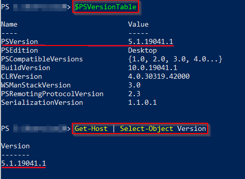

Apresento aqui duas opções:

## 1. Lendo variável

```terminal
$PSVersionTable
```

### 2. Get-Host 
***
```terminal
Get-Host | Select-Object Version
```

Veja abaixo o resultado de ambos os comandos:

