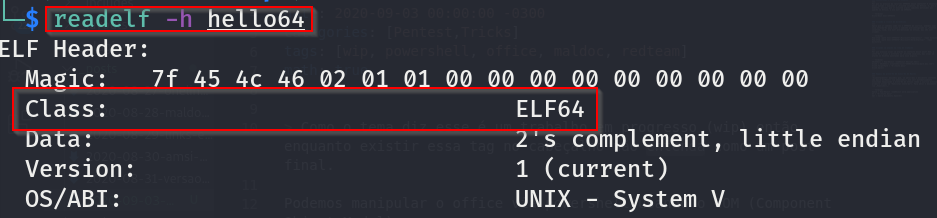
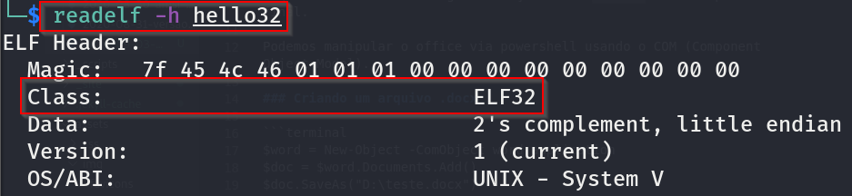

ELF é o formato de arquivos binários do Linux. É um padrão que define a estrutura que os arquivos binários *devem* seguir para que o sistema operacional consiga interpretar o seu conteúdo. Um arquivo ELF pode ser de vários tipos (executável, objetos relocáveis, bibliotecas compartilhadas, e _dumps_) e por isso possui um local específico dentro dele para definir qual é o tipo do arquivo que está sendo lido. O sistema operacional sabe como tratar o arquivo com base no tipo definido nesse campo.

## Arquitetura
***
Outra informação importante que o cabeçalho de um arquivo ELF carrega é a arquitetura para a qual o binário foi compilado (32 ou 64 bits). No cabeçalho do arquivo existe um campo chamado *Class* onde essa informação está registrada. Podemos usar o comando *readelf* para ler o conteúdo do cabeçalho de um binário. A nível de exemplo eu compilei um código simples para as duas plataformas e, com o comando *readelf* apresento abaixo o resultado:
 

## Sessões
***
Sessões são locais reservados dentro dum arquivo ELF com objetivos predefinidos. Além de objetivos diferentes, as sessões têm *permissões* diferentes. Por exemplo, um programador criou em seu código uma variável “nome” que irá receber o nome do usuário. Obviamente esse espaço do ELF precisará de permissão de escrita afinal de contas o programa não inicia já contendo o nome do usuário nesse local – ele será preenchido depois que o programa já estiver em execução e o usuário digitar o próprio nome.

Já outras informações já vêm preenchidas quando o programa inicia e, enquanto está criando o programa, o desenvolvedor define que essas informações não poderão ser alteradas – por isso elas não são chamadas de variáveis, mas sim de *constantes*. Tendo em vista que essa parte do ELF não vai sofrer alterações durante a execução do programa, ela não vai precisar de permissão de escrita, apenas de leitura. E assim nasce as permissões!

Com certeza esse assunto de permissões nos levam para outras considerações mais interessantes. Mas deixarei para uma próxima.

  <b>Processos:</b> Um processo é um programa em execução. Então imagine que o binário criado no formato ELF, ao ser executado, é copiado para uma região de memória e ganha vida dentro do sistema operacional! Esse é o processo – o programa em execução. Tenha em mente também que o binário é “espelhado” na memória, sendo assim as sessões que comentamos anteriormente irão existir em regiões da memória alocadas para aquele processo."

Em um ELF as sessões mais comuns são:

<table class="table">
  <thead class="thead-dark">
    <tr>
      <th scope="col">.data</th>
      <th scope="col">.rodata</th>
      <th scope="col">.bss</th>
      <th scope="col">.got</th>
      <th scope="col">.plt</th>
    </tr>
  </thead>
  <tbody>
    <tr>
      <td>Dados inicializados com permissão de Leitura e escrita.</td>
      <td>Dados inicializados com permissão de apenas leitura.</td>
      <td>Dados NÃO inicializados com permissão de leitura e escrita.</td>
      <td>Uma tabela contendo os endereços de memória das funções.</td>
      <td>Aponta nomes de funções para as entradas na <b>.got</b></td>
    </tr>
  </tbody>
</table>

  Levando em conta que a <b>.got</b> aponta para o endereço de momória onde se encontra uma determinada função, o que aconteceria caso nós tivéssemos o privilégio de alterar os endereços na <b>.got</b>?

