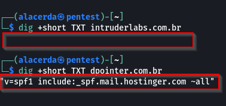
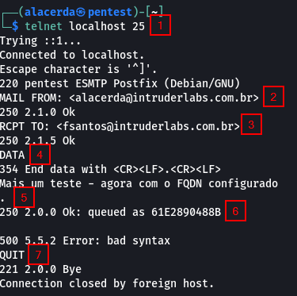

De maneira simples, o Sender Policy Framework (SPF) é usado para verificar se um dado email foi enviado por um servidor autorizado pelo domínio de origem.


## Por que é necessário?
***
A falta de uma entrada SPF no servidor DNS permite que agentes maliciosos enviem  emails como se fossem daquela empresa - e-mail spoofing.

## Procurando por SPF num domínio
***
Usando o comando dig

```terminal
dig +short TXT dpointer.com.br
```
Veja abaixo a diferença entre um domínio sem o SPF configurado (intruderlabs.com.br) e um onde o SPF está configurado (dpointer.com.br)



Isso significa que o domínio intruderlabs.com.br está vulnerável a E-mail Spoof. Para fazer um teste, instalei e iniciei o postfix localmente. Depois com os comandos abaixo anviei um email para FSantos a partir do usuário Alacerda. Veja abaixo.



E, como resultado o email chegou para o usuário FSantos. Mas perceba que pelo menos caiu na caixa de Spam.


## Referências
[1] https://www.dmarcanalyzer.com/spf/how-to-create-an-spf-txt-record/
[2] https://www.dmarcanalyzer.com/spf/checker/
[3] https://www.alibabacloud.com/help/faq-detail/37532.htm