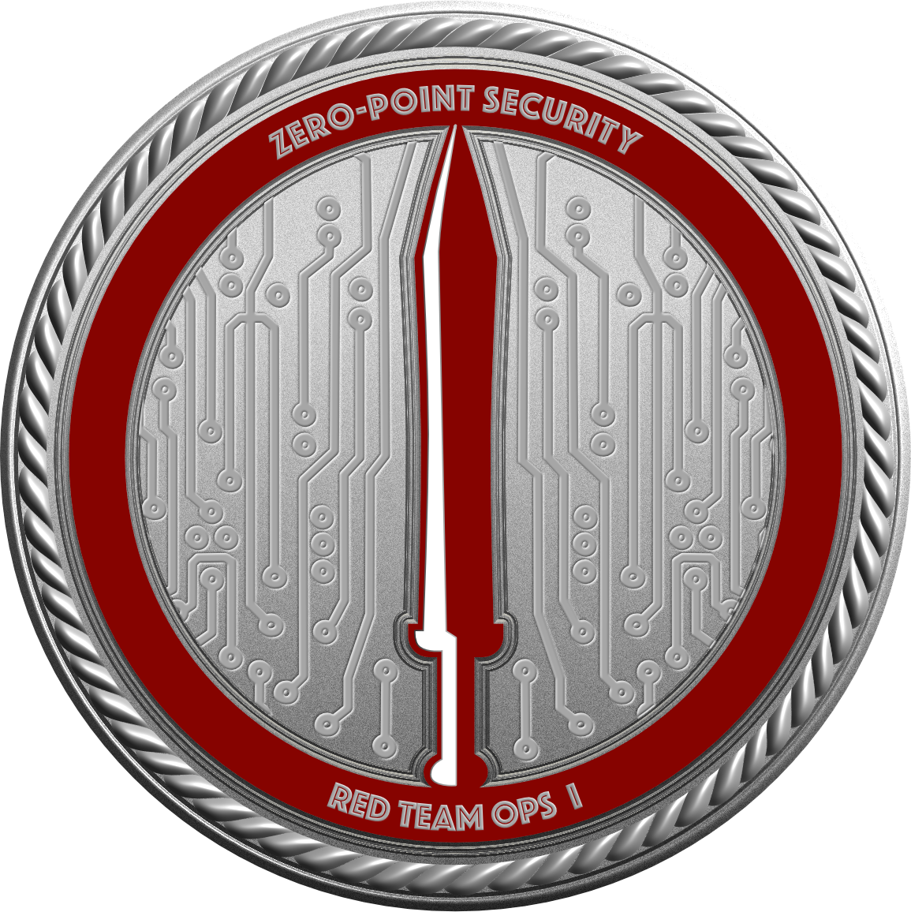
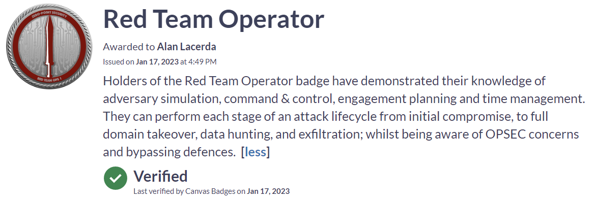

Acabo de realizar o treinamento [Red Team Ops da Zero Point Security](https://training.zeropointsecurity.co.uk/courses/red-team-ops) 
e a prova para a certificação associada - [CRTO (Certified Red Ream Operator)](https://eu.badgr.com/public/badges/Od2nC1yPRPaDC9UCJ8W7Lg) 
desenvolvida por [Daniel Duggan a.k.a rastamouse](https://www.linkedin.com/in/daniel-rastamouse-duggan/) e nesse post quero compartilhar
um pouco dessa experiência.

Admito que essa não foi uma jornada simples de concluir mas valeu a pena. Venho de uma série de treinamentos envolvendo a área de Segurança 
Ofensiva e graças às atividades que desenvolvo na [iSecurity](https://isecurityconsulting.com) e [IntruderLabs](https://intruderlabs.com.br) 
tenho tido a oportunidade de colocar muito do que aprendo em prática. Isso com certeza ajudou bastante a digerir o conteúdo do treinamento 
enquanto eu entendia diversos pontos que eu precisava/preciso me aprofundar mais.

## O Treinamento
o conteúdo do treinamento pode ser encontrado facilmente [aqui](https://training.zeropointsecurity.co.uk/courses/red-team-ops). O currículo é 
bastante extenso e detalhado. No treinamento o ``Rasta`` detalha cada passo para cada ataque além de incluir alguns vídeos mostrando o ataque 
sendo realizado.

``Eu`` diria que os maiores destaques nesse treinamento foram: 
- Cobalt Strike: No treinamento é destrinchado diversas features desse C2 tão cobiçado (eu não disse que é o melhor que existe). Ter domínio 
do Cobalt Strike é um asset valioso no arsenal de um Operador de Red Team.
- MS Defender AV.: Burlar as defesas do MS Defender AV é um dos tópicos mais importantes pois sem isso você não vai conseguir comprometer as 
máqinas. Essa habilidade é um diferencial imenso para o profissional de segurança ofensiva.
- Kerberos: Explorar o protocolo de autenticação Kerberos é um conhecimento necessário para explorar e se estabelecer na rede alvo e o treinamento 
cobre esse tópico com vários dos ataques que são de conhecimento "obrigatório" para um RTO.

Além desses pontos, diversas vezes durante o treinamento o aluno é alertado sobre o OPSEC. Ou seja, qual comportamento do RTO poderia disparar 
um alerta por ser uma atividade anômala e como melhorar a técnica para que ela pareça mais com uma atividade legítima da rede. 

Finalmente, vale citar que você tem acesso vitalício ao material do treinamento e também a todas as atualizações lançadas no curso após a sua compra.

## O Exame

O Exame tem a duração de 48 horas que podem ser distribuídas a seu critério no intervalo de 4 dias. Ou seja, você vai ter tempo suficiente para 
descansar durante os 4 dias que as 48 horas de prova são válidas. Na prova você recebe uma máquina windows-atacante, uma linux-atacante e mais uma máquina que simula a máquina dentro da rede que você deve 
coprometer. Essa terceira máquina representa uma máquina que o cliente tenha forneceido para você iniciar seu ataque na rede da empresa.

``FELIZMENTE`` não é necessário escrever relatório para esse exame. Basta conseguir acesso aos arquivos contendo as flags dentro de cada máquina. Existe um 
caminho a ser seguido (uma ordem de máquinas a serem comprometidas) e as flags seguem essa sequência: flag1.txt, flag2.txt e assim por diante. É possível pegar 
a flag2 antes da flag1? Não, pois apenas a informação na máquina que contém a flag1 dará acesso à máquina da flag2. Por isso a 
sequência de flags funciona bem.

Mesmo durante o exame eu aprendi/reforcei conceitos ensinados no curso. Na etapa de pivotagem foi onde cheguei a pensar que iria perder na prova, 
mas o material é bem claro e ajudou bastante a esclarescer as dúvidas.

### Problemas?

Nem tudo são flores. Embora no laboratório do curso tudo tenha corrido muito bem, na prova eu tive diversos problemas na infra. Basicamente precisei fazer a 
prova três vezes.
- O Lab travou todo e precisei resetar (já estava na flag 5)
- O reiniciou sozinho (eles têm uma regra maluca lá de que o aluno tem que interagir com a plataforma a cada duas horas senão o Lab reinicia. Eu estava 
concentrado na prova, atacando os alvos e esqueci de clicar em qualquer lugar da plataforma). Alguém pode-me convencer de que isso é inteligente/necessário?
- A equipe de suporte é uma "equipe de um homem só"! Se precisamos de um suporte durante a prova e for madrugada o ``Rasta`` vai estar dormindo, não adianta chorar!

## Finalmente

Mesmo com os  ``Problemas`` citados acima, sem sombra de dúvida vale muito a pena realizar esse treinamento e se esforçar em vencer os desafios da prova de 
certificação. A bagagem de aprendizado que será obtida por meio desse treinamento vai realmente te preparar para exercicios de Red Team e, mesmo que você só realize 
pentests esse conhecimento vai ser bastante útil em exercícios de pentest em infraestrutura interna. Então no final do dia, você terá um arsenal maior de 
técnicas para utilizar nos seus próximos exercícios.

